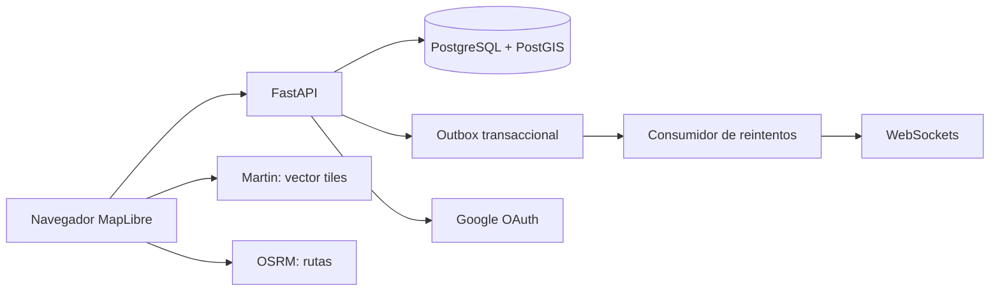

# Hacer TDD de aqui en adelante

# Crear un flujo de trabajo en nuevas publicaciones de tal forma que sea intuitivo y facil ya que muchas personas
# mayores u con ocupaciones necesitan preocuparse lo menos posible si quedo bien la publicacion, 
# el actual es un form pero no se 
# si sea la forma en la que un niño de 5 años vea facil hacer una publicacion

# Los datos de osm maps se estan descargando a travez de un .sh y esto debe estar en docker por unicidad

# Primera: requisitos y diseño

## Objetivo y alcance

Permitir que personas publiquen inmuebles en arriendo dentro de Bogotá y que visitantes los encuentren en un mapa. Esta iteración mantiene el alcance existente de la aplicación: inmuebles de arriendo, acceso mediante Google y mapa público. Venta, mensajería privada, pagos, moderación administrativa y verificación manual del inmueble quedan para una siguiente etapa.

## Requisitos funcionales

1. Un visitante puede ver las publicaciones disponibles en el mapa y consultar su descripción, contacto, fotos y ubicación.
2. Una persona puede iniciar y cerrar sesión con Google. La identidad requiere un correo verificado y en caso de 
hacer click para contactar al propietario o querer publicar, debe autenticarse mendiante un codigo enviado via whatsapp de 
unico uso y solo se debe autenticar una vez.
3. Una persona autenticada puede crear una publicación (solo una: 1 por persona autenticada) con título, descripción, tipo de inmueble, teléfono, hasta cuatro imágenes y ubicación dentro del área de Bogotá.
4. El propietario puede retirar su publicación o los usuarios admin root. Nadie más puede modificarla o retirarla.
5. Los navegadores conectados reciben altas y retiros por WebSocket. Al reconectarse, vuelven a cargar el estado desde PostgreSQL.
6. Repetir la misma solicitud de creación con la misma clave de idempotencia y el mismo contenido devuelve la publicación original. Reutilizar la clave con otro contenido se rechaza.
7. Si falla el procesamiento del evento, se conserva en la outbox y el consumidor reintenta. WebSockets desconectados se eliminan de la lista; al reconectarse, el navegador carga las publicaciones desde PostgreSQL.
8. La persona puede recuperar el acceso mediante el mecanismo de recuperación de Google. El sistema no guarda contraseñas locales.
9. Los usuarios con permiso para mas de 1 publicacion: Pueden publicar sin estar en el sitio ya son verificados por un admin y que pueden hacer varias publicaciones el mismo dia, 
para ellos debe haber un formulario en el que puedan ingrasar la direccion y la lat y long de la propiedad
para los demas usuarios es obligatorio que es esten en el sitio para garantizar la ubicacion

## Requisitos no funcionales

- **Seguridad:** cookies `HttpOnly`, `SameSite=Lax`; `Secure` en producción; JWT de vida limitada; validación en el servidor; permisos comprobados por propietario.
- **Integridad:** claves foráneas, unicidad para correo/identificador de sesión/idempotencia, restricción de categorías y geometría PostGIS.
- **Resiliencia:** escritura de la publicación, respuesta idempotente y evento outbox en una transacción; reintentos con espera creciente.
- **Observabilidad:** logs JSON con request ID, ruta, código HTTP y duración; sin tokens o contraseñas.
- **Rendimiento:** índice espacial GIST; endpoint de salud; pool de conexiones de SQLAlchemy.
- **Despliegue:** contenedor con usuario root; CI construye la imagen y CD publica a GHCR con tags de rama y versión.
- **Alcance operativo:** la outbox se consume dentro del proceso FastAPI y por ahora cubre notificaciones en tiempo real. Si se requieren varios procesos/instancias con entrega a todos los WebSockets, el siguiente paso es un broker compartido (por ejemplo Redis Pub/Sub) o un worker separado (Redefinir el alcance operativo).

## Arquitectura

FastAPI organiza autenticación, publicaciones y endpoints de mapa en un monolito. PostgreSQL guarda identidad, sesiones, publicaciones, claves idempotentes y eventos. PostGIS resuelve geometrías. Martin sirve las capas vectoriales desde vistas SQL; OSRM calcula rutas desde el navegador.

## Modelo de datos y relaciones

- `usuarios(id PK, google_id UNIQUE, email UNIQUE, nombre, foto_url, activo, creado_en)`.
- `casas(id PK, usuario_id FK nullable -> usuarios.id, nombre, descripcion, ubicacion geography(Point,4326), tipo, telefono, fotos jsonb, creado_en)`. El usuario es nullable para conservar datos precargados anteriores al login.
- `auth_sessions(id PK, usuario_id FK -> usuarios.id ON DELETE CASCADE, jti_hash UNIQUE, created_at, expires_at, revoked_at)`.
- `idempotency_keys(usuario_id FK, idem_key, request_hash, response_json, created_at, PK(usuario_id, idem_key))`.
- `outbox_events(id PK, event_type, aggregate_id, payload, created_at, processed_at, attempts, next_attempt_at, last_error)`.

### Restricciones e índices

- `casas.tipo` admite `apartamento`, `habitacion`, `apartaestudio` o `casa`.
- La ubicación debe ser un punto SRID 4326 y la API restringe las coordenadas al rectángulo de Bogotá.
- Título, descripción, teléfono y fotos tienen longitudes y formatos limitados por el modelo de entrada.
- Las fotos aceptan JPEG, PNG y WebP en data URI, con máximo de cuatro, 10 MB por archivo original en el navegador y 1 MB de contenido binario final en el servidor. Para producción se deben almacenar en un servicio de objetos.
- Claves únicas impiden duplicar cuentas por ID Google, sesiones por JTI y operaciones por usuario/clave.
- Índices: GIST para ubicación, btree para propietario y sesiones, índice parcial para eventos pendientes.

## Autenticación y sesión

Google OAuth utiliza un `state` aleatorio en cookie temporal y valida que el correo retornado sea verificado. El servidor firma un JWT de siete días y persiste únicamente un hash de su JTI. Cada solicitud autenticada verifica que la sesión siga vigente y que la cuenta esté activa. Cerrar sesión revoca la fila y elimina la cookie. El secreto JWT es obligatorio, debe tener al menos 32 caracteres y no puede ser un valor de ejemplo.

La recuperación de contraseña es delegada al proveedor de identidad. Si se agregan contraseñas locales, se requerirán hash Argon2id, confirmación de correo, tokens de restablecimiento de un solo uso y un proveedor SMTP/transaccional; esas funciones no están en esta versión.

## Reintentos e idempotencia

1. El navegador genera un UUID al comenzar el envío y lo conserva si recibe error o timeout.
2. FastAPI valida la clave, valida los datos y calcula el hash de la solicitud.
3. En una sola transacción, inserta la clave idempotente, la publicación, la respuesta y el evento outbox.
4. Una repetición con clave y hash iguales devuelve la respuesta guardada. La misma clave con otro hash devuelve `409`.
5. El consumidor bloquea eventos pendientes con `SKIP LOCKED`, los entrega al WebSocket y los marca procesados. Si ocurre un error, deja el evento pendiente, incrementa intentos y aplica espera exponencial acotada.

## Logging y seguridad operativa

Se registran solicitudes, errores de OAuth sin contenido de credenciales, errores de persistencia, fallos de salud y fallos del consumidor. Los logs no incluyen cabeceras de autorización, cookies, parámetros de token ni contenido de las publicaciones. Las credenciales se configuran por `.env`, excluido de Git; el archivo de ejemplo no contiene secretos reales.

## CI/CD

- **CI:** pull requests y pushes a `main`; revisa sintaxis Python y construye el contenedor.
- **CD:** pushes a `main` y etiquetas `vX.Y.Z`; publica la imagen a GitHub Container Registry. La actualización del servidor se configura según el proveedor elegido.

## Pendientes para una segunda iteración

Filtros de mapa; venta además de arriendo; precio y moneda como campos estructurados; estados de borrador/moderación/publicación; edición de inmuebles; carga de imágenes a almacenamiento de objetos; política de borrado y retención; rate limiting distribuido; broker compartido para varias instancias; y despliegue automático al proveedor objetivo.
